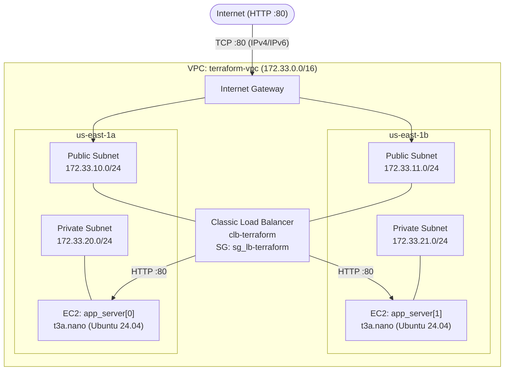

# terraform-sandbox

Repositorio sandbox de Terraform para aprovisionar una arquitectura básica en AWS compuesta por una **VPC**, un **Classic Load Balancer (CLB)** en subredes públicas y **2 instancias EC2 (Ubuntu 24.04)** en subredes privadas distribuidas en dos zonas de disponibilidad.

---

## Arquitectura General



Para ver los diagramas detallados (grafo de dependencias de Terraform, flujo de tráfico y análisis técnico completo), consulta [`docs/architecture.md`](docs/architecture.md).

---

## Estructura del Repositorio

| Archivo | Descripción |
| :--- | :--- |
| [`main.tf`](main.tf) | Configuración de Terraform, provider AWS, módulo VPC, instancias EC2, Security Group con sus reglas y Classic Load Balancer. |
| [`variables.tf`](variables.tf) | Declaración de variables de entrada (`aws_access_key`, `aws_secret_key`, `aws_region`). |
| [`dev.tfvars.example`](dev.tfvars.example) | Plantilla de ejemplo para definir los valores de variables en un archivo `dev.tfvars` local. |
| [`.gitignore`](.gitignore) | Excluye directorios `.terraform/`, archivos de estado (`*.tfstate*`), archivos `*.tfvars` con secretos y archivos de override. |
| [`docs/architecture.md`](docs/architecture.md) | Documentación técnica detallada, diagramas Mermaid y observaciones de revisión. |

---

## Requisitos Previos

- **Terraform** `>= 1.10.0`
- **Provider AWS** (`hashicorp/aws`) `>= 5.80.0`
- Credenciales de AWS con permisos para gestionar VPC, EC2, Security Groups y Classic Load Balancer.

---

## Variables de Entrada

| Nombre | Tipo | Default | Sensitive | Descripción |
| :--- | :--- | :--- | :---: | :--- |
| `aws_access_key` | `string` | *(requerida)* | No | AWS Access Key |
| `aws_secret_key` | `string` | *(requerida)* | Sí | AWS Secret Access Key |
| `aws_region` | `string` | `"us-east-1"` | No | Región de AWS |

---

## Uso

1. **Crear el archivo de variables local** a partir de la plantilla:
   ```bash
   cp dev.tfvars.example dev.tfvars
   ```
   Completar los valores en `dev.tfvars` (este archivo está ignorado por Git):
   ```hcl
   aws_access_key = "TU_ACCESS_KEY"
   aws_secret_key = "TU_SECRET_KEY"
   aws_region     = "us-east-1"
   ```

2. **Inicializar Terraform** (descarga providers y el módulo `terraform-aws-modules/vpc/aws`):
   ```bash
   terraform init
   ```

3. **Previsualizar el plan de ejecución**:
   ```bash
   terraform plan -var-file="dev.tfvars"
   ```

4. **Aplicar la infraestructura**:
   ```bash
   terraform apply -var-file="dev.tfvars"
   ```

5. **Destruir la infraestructura** cuando finalices las pruebas:
   ```bash
   terraform destroy -var-file="dev.tfvars"
   ```