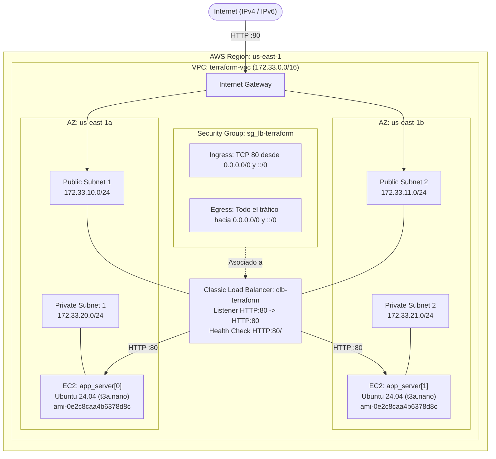
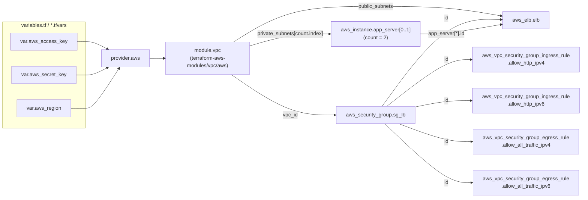
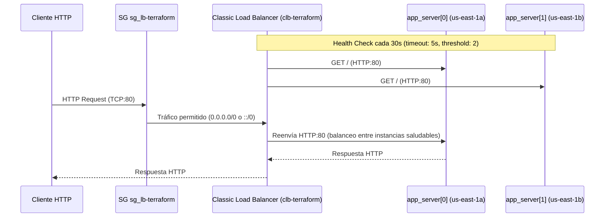

# Documentación Técnica y Diagramas de Arquitectura

Este documento detalla la infraestructura definida como código (IaC) en los scripts de Terraform del repositorio `terraform-sandbox`, incluyendo diagramas de arquitectura de red, grafo de dependencias de recursos, flujo de tráfico y observaciones técnicas.

---

## 1. Diagrama de Arquitectura AWS

La configuración despliega una VPC (`172.33.0.0/16`) distribuida en dos zonas de disponibilidad (`us-east-1a` y `us-east-1b`), con un Classic Load Balancer en las subredes públicas que balancea tráfico HTTP hacia dos instancias EC2 ubicadas en las subredes privadas.

---

## 2. Grafo de Dependencias de Terraform

El siguiente diagrama muestra cómo se relacionan las variables, el proveedor y los recursos definidos en [`variables.tf`](../variables.tf) y [`main.tf`](../main.tf).

---

## 3. Flujo de Tráfico y Health Checks

---

## 4. Detalle de los Scripts

### 4.1. [`main.tf`](../main.tf)

#### Requisitos de Terraform y Provider
| Componente | Configuración |
| :--- | :--- |
| **Terraform** | `>= 1.10.0` |
| **Provider AWS** | `hashicorp/aws` versión `>= 5.80.0` |
| **Región** | `var.aws_region` (por defecto `us-east-1`) |
| **Credenciales** | `var.aws_access_key` y `var.aws_secret_key` |

#### Módulo VPC (`module.vpc`)
Utiliza el módulo oficial de la comunidad `terraform-aws-modules/vpc/aws`.

| Parámetro | Valor |
| :--- | :--- |
| `name` | `terraform-vpc` |
| `cidr` | `172.33.0.0/16` |
| `azs` | `["us-east-1a", "us-east-1b"]` |
| `public_subnets` | `["172.33.10.0/24", "172.33.11.0/24"]` |
| `private_subnets` | `["172.33.20.0/24", "172.33.21.0/24"]` |
| `tags` | `terraform = "true"`, `enviroment = "dev"` |

> Al definir `public_subnets`, el módulo crea automáticamente un Internet Gateway y las tablas de ruteo públicas. Como `enable_nat_gateway` no está especificado, permanece en `false` (las subredes privadas no tienen salida directa a Internet).

#### Instancias EC2 (`aws_instance.app_server`)
| Parámetro | Valor |
| :--- | :--- |
| `count` | `2` |
| `ami` | `ami-0e2c8caa4b6378d8c` (Canonical Ubuntu 24.04 amd64 Noble en `us-east-1`) |
| `instance_type` | `t3a.nano` |
| `subnet_id` | `module.vpc.private_subnets[count.index]` (`172.33.20.0/24` y `172.33.21.0/24`) |
| `tags` | `terraform = "true"`, `enviroment = "dev"` |

#### Security Group (`aws_security_group.sg_lb`) y Reglas
Asociado al Classic Load Balancer dentro de `module.vpc.vpc_id`.

| Recurso | Dirección | Protocolo | Puerto | Origen / Destino |
| :--- | :--- | :--- | :--- | :--- |
| `allow_http_ipv4` | Ingress | TCP | `80` | `0.0.0.0/0` |
| `allow_http_ipv6` | Ingress | TCP | `80` | `::/0` |
| `allow_all_traffic_ipv4` | Egress | Todos (`-1`) | Todos | `0.0.0.0/0` |
| `allow_all_traffic_ipv6` | Egress | Todos (`-1`) | Todos | `::/0` |

#### Classic Load Balancer (`aws_elb.elb`)
| Parámetro | Valor |
| :--- | :--- |
| `name` | `clb-terraform` |
| `subnets` | `module.vpc.public_subnets` |
| `security_groups` | `[aws_security_group.sg_lb.id]` |
| `instances` | `aws_instance.app_server[*].id` |
| **Listener** | `HTTP:80` -> `HTTP:80` |
| **Health Check** | `HTTP:80/`, `interval = 30`, `timeout = 5`, `healthy_threshold = 2`, `unhealthy_threshold = 2` |
| `tags` | `terraform = "true"`, `enviroment = "dev"` |

---

### 4.2. [`variables.tf`](../variables.tf) y [`dev.tfvars.example`](../dev.tfvars.example)

| Variable | Tipo | Default | Sensitive | Descripción |
| :--- | :--- | :--- | :--- | :--- |
| `aws_access_key` | `string` | *(requerida)* | `false` | AWS Access Key |
| `aws_secret_key` | `string` | *(requerida)* | `true` | AWS Secret Access Key |
| `aws_region` | `string` | `"us-east-1"` | `false` | Región de AWS donde se despliegan los recursos |

El archivo [`dev.tfvars.example`](../dev.tfvars.example) provee una plantilla para crear `dev.tfvars` localmente (el cual está excluido de Git mediante `.gitignore`).

---

## 5. Observaciones Técnicas y Oportunidades de Mejora

Durante el análisis estático de los scripts se identificaron los siguientes puntos a considerar antes de usar esta configuración en entornos reales:

1. **Security Group dedicado para EC2**: Las instancias `app_server` no tienen asignado un Security Group explícito, por lo que heredan el SG por defecto de la VPC (que solo permite tráfico desde el mismo SG). Para que `clb-terraform` pueda alcanzar el puerto `80` de las instancias y superar los health checks, conviene crear un SG para EC2 que permita ingreso TCP `80` únicamente desde `aws_security_group.sg_lb.id`.
2. **Servidor web / `user_data`**: Las instancias EC2 no incluyen `user_data` ni aprovisionamiento que inicie un servicio HTTP en el puerto `80`, por lo que inicialmente los health checks (`HTTP:80/`) fallarán hasta configurar un servidor web.
3. **Classic Load Balancer (CLB)**: `aws_elb` corresponde a la generación anterior de balanceadores en AWS. Se recomienda migrar a un Application Load Balancer (`aws_lb` con `load_balancer_type = "application"`).
4. **Acoplamiento a `us-east-1`**: Aunque `aws_region` es una variable, las zonas de disponibilidad (`us-east-1a`, `us-east-1b`) y el ID de la AMI (`ami-0e2c8caa4b6378d8c`) están definidos de forma fija para `us-east-1`. Usar un `data "aws_ami"` y `data "aws_availability_zones"` haría la configuración portable entre regiones.
5. **Versión del módulo VPC sin fijar**: `module "vpc"` no declara un atributo `version`, lo que puede provocar cambios inesperados entre despliegues.
6. **Manejo de credenciales**: Pasar `aws_access_key` y `aws_secret_key` por variables es práctico en un sandbox, pero en producción es preferible autenticar mediante perfiles de AWS CLI, variables de entorno (`AWS_ACCESS_KEY_ID`, `AWS_SECRET_ACCESS_KEY`) o roles IAM. Además, `aws_access_key` debería marcarse con `sensitive = true`.
7. **Outputs faltantes**: Agregar un archivo `outputs.tf` (por ejemplo, con `aws_elb.elb.dns_name`, `module.vpc.vpc_id` e IPs privadas de `app_server`) facilitaría inspeccionar los recursos tras `terraform apply`.
8. **Typo en etiqueta (`tags`)**: La clave de etiqueta está escrita como `enviroment` en lugar de `environment`.
